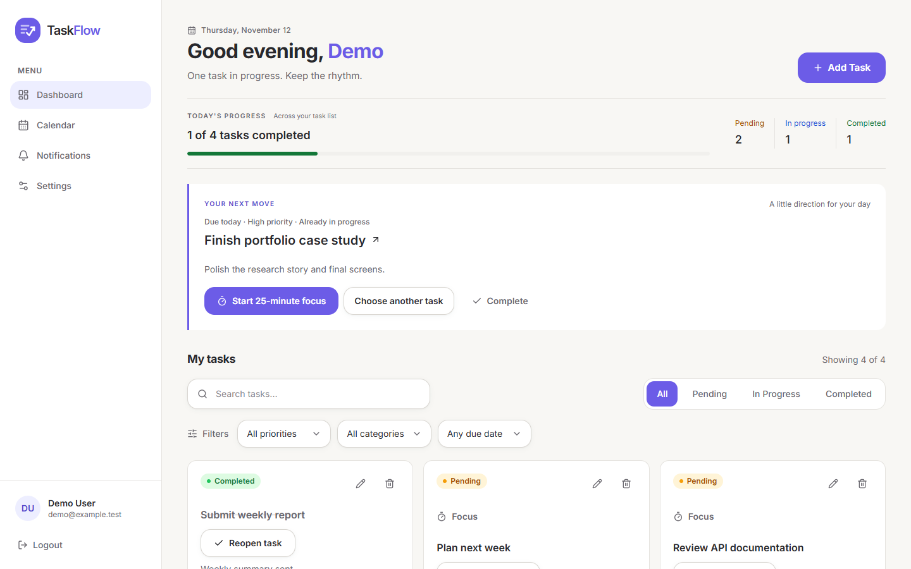
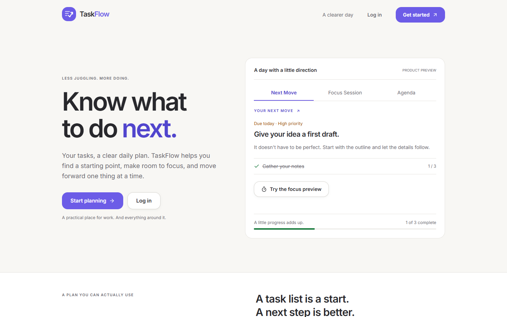
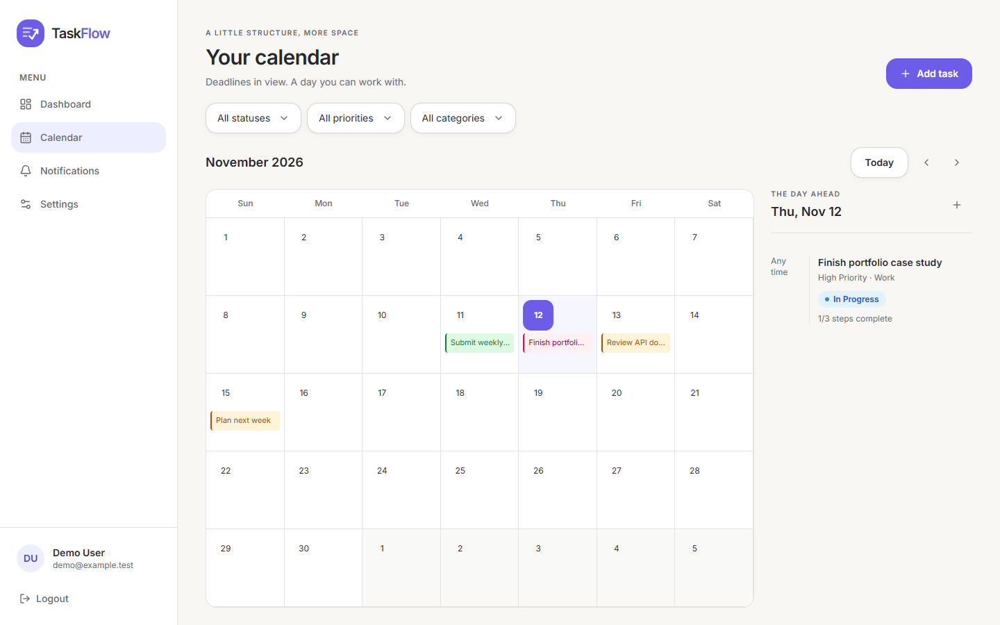
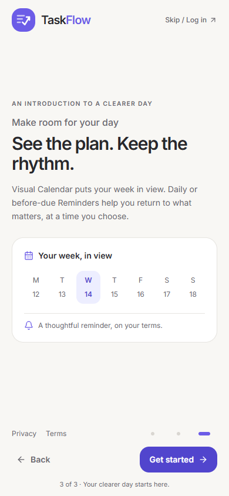
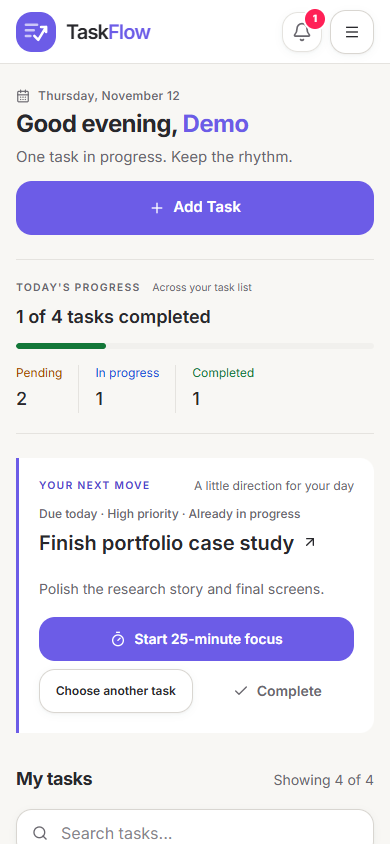
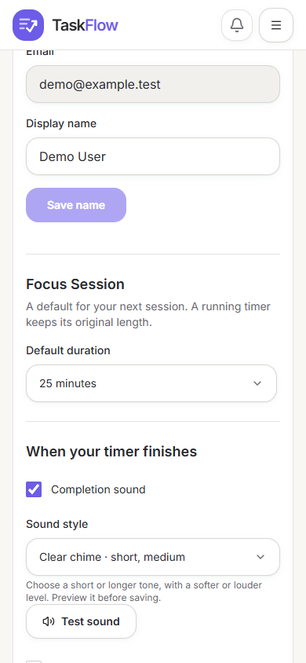

<div align="center">
  
  <h1>TaskFlow</h1>
  <p><strong>Know what to do next.</strong></p>
  <p>A full-stack task manager for choosing a useful next step, focusing on it, and keeping deadlines in view.</p>
</div>

## Product preview



<p align="center">
  
  
</p>
<p align="center">
  
  
  
</p>

## Why TaskFlow

A task list can leave the hardest question unanswered: where to begin. TaskFlow surfaces a **Next Move**, offers a configurable Focus Session, and keeps due dates and reminders visible in a calendar. Its responsive interface supports keyboard use and small screens.

## Features

- Account registration and login with JWT authentication and user-scoped tasks.
- Create, edit, delete, reopen, and undo task completion.
- Priorities, categories, due dates, checklists, task reminders, search, and filters.
- Deterministic Next Move recommendations based on task status, priority, and deadlines.
- 15, 25, 45, or 60-minute Focus Sessions that persist across navigation and refresh.
- Selectable local completion tones and a visible completion prompt while the app is active.
- Monthly desktop calendar and a compact mobile agenda.
- In-app Notifications page with read/unread state.
- Profile preferences, Light/Dark/System themes, password change, and account deletion.
- Three-step mobile welcome, Privacy Policy, and Terms of Use.

**Notifications are currently in-app.** Focus completion audio runs while the browser or installed PWA is active enough to execute the app. Browser notifications depend on device/browser permissions. Background Web Push is not implemented; exact delivery after the browser closes is not available.

## Technology

React 19, TypeScript, TanStack Start and Router, TanStack Query, Vite, Bun, Tailwind CSS 4, Radix UI, Express 5, MongoDB, Mongoose, JWT, bcrypt, Vitest, Nitro, Vercel Node Functions, and Swagger/OpenAPI.

## Architecture

The browser and Express API share an origin. Client calls use relative `/api` paths in local development and production. Express serves the API locally and Nitro packages it as a Node function for Vercel. MongoDB stores accounts and tasks; protected task operations are scoped to the authenticated account. Server secrets are supplied through environment variables and are not part of the client bundle.

## Getting started

Prerequisites: Bun, Node.js 22, and a reachable MongoDB database.

```bash
bun install
```

Copy `backend/.env.example` to `backend/.env` and privately set `MONGODB_URI`, `JWT_SECRET`, and `FRONTEND_URL`. Do not commit that file. No root frontend API URL is needed; requests use same-origin `/api`.

In one terminal, start the standalone backend:

```bash
cd backend
npm start
```

In another terminal at the repository root:

```bash
bun run dev
```

Open `http://localhost:8080`. Vite also prints a Network URL for other devices on the same Wi-Fi. LAN access uses the frontend origin and `/api`; browser requests do not target the phone's localhost. The standalone API listens on port 3000; its Swagger UI is at `/api-docs/` on that server. During Vite development, the API is available under `/api`.

## Environment variables

| Variable       | Purpose                                                         |
| -------------- | --------------------------------------------------------------- |
| `MONGODB_URI`  | Private MongoDB connection string for the server.               |
| `JWT_SECRET`   | Long, random server-only JWT signing secret.                    |
| `FRONTEND_URL` | Frontend origin for configured cross-origin CORS compatibility. |
| `PORT`         | Optional standalone backend port; defaults to `3000`.           |

Never expose database credentials or `JWT_SECRET` through a `VITE_` variable. `VITE_API_URL` is not used.

## Quality checks

Verified in this repository:

- Frontend: **38 tests passed** across 8 files.
- Backend: **13 tests passed**.
- `bunx tsc --noEmit`: passed.
- `bun run build`: passed.
- `NITRO_PRESET=vercel bun run build`: passed.
- `node scripts/verify-vercel.mjs`: passed against the generated Vercel function.
- `bun run lint`: zero errors; six existing React Fast Refresh warnings.
- `git diff --check`: passed.

See [QA_REPORT.md](QA_REPORT.md) for browser coverage and [DEPLOYMENT.md](DEPLOYMENT.md) for hosting setup.

## Deployment

Deployment has not been performed. The documented target is Vercel Hobby for a personal, non-commercial portfolio and MongoDB Atlas Free, with a Vercel-provided `vercel.app` hostname. Free plans have usage/resource limits and serverless cold starts. Review [DEPLOYMENT.md](DEPLOYMENT.md) for environment setup and manual checks.

## Current limitations

- No background Web Push or lock-screen delivery.
- Forgotten-password email recovery needs an external email provider and is unavailable.
- Focus sound and optional browser notifications depend on browser/device support, permission, network, and platform settings; alerts are not guaranteed after the browser fully closes.
- Free hosting has usage caps and cold-start latency. No live deployment has been verified.

## Author

**Manal Bafaraj**

- [Portfolio](https://manalbafaraj.github.io/portfolio/)
- [GitHub](https://github.com/ManalBafaraj)
